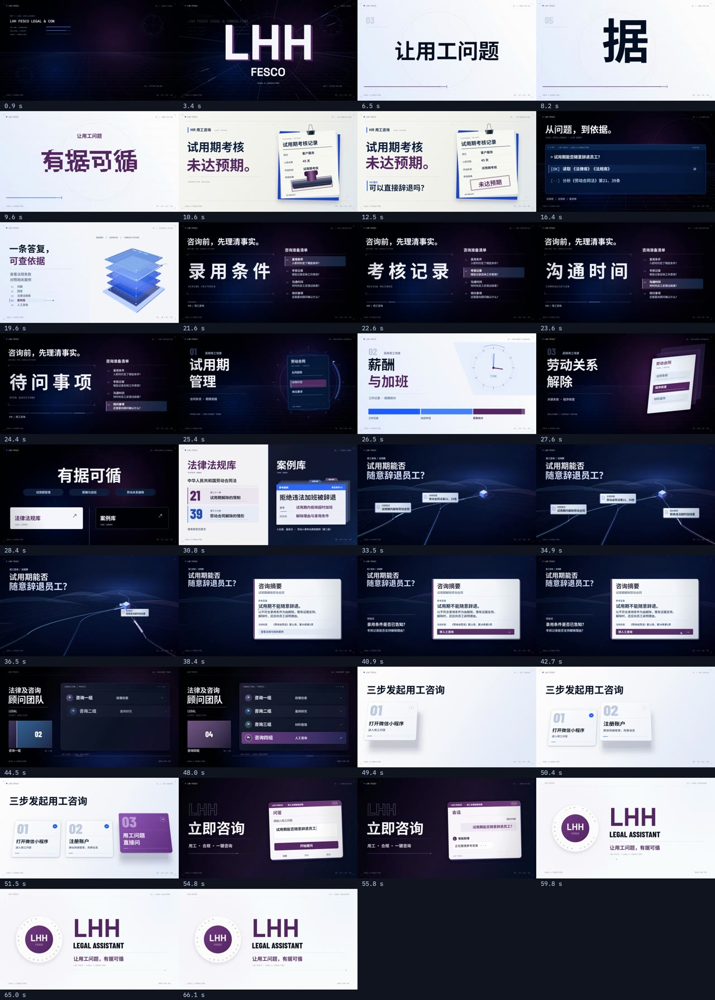

# Dennis Motion Film Skill

把品牌资料、产品流程和音乐做成可编辑的动态宣传片。内含 LHH《让用工问题，有据可循》的公开示例工程，以及按用途整理的 Video Shotcraft 镜头库。

[下载 Skill 安装包](https://github.com/Lemomnblues/dennis-motion-film-skill/releases/latest/download/dennis-motion-film.zip) · [下载 1080p 示例](https://github.com/Lemomnblues/dennis-motion-film-skill/releases/latest/download/dennis-motion-film-demo.mp4) · [查看 13 段分镜](skills/dennis-motion-film/assets/lhh-film/analysis/timeline.md) · [浏览 124 张镜头卡与 150 段动态预览](skills/dennis-motion-film/references/shots.md)



## 安装与调用

解压安装包，将 `dennis-motion-film` 目录放入 `~/.codex/skills/`。也可以从仓库的 `skills/` 目录复制同名文件夹。在新的 Codex 对话中输入：

> 用 $dennis-motion-film，把我提供的品牌资料和产品界面做成一支 30 秒横屏宣传片。跟随音乐卡点，片尾引导预约演示，交付 MP4 和可编辑工程。

本地选镜头时，双击 `skills/dennis-motion-film/assets/video-shotcraft/gallery/index.html`。可以用中文用途、英文名称或类别查找，直接播放随包的视频，查看镜头卡与源码。

## 重渲 LHH 公开示例

需要 Node.js 22.12 或以上、Python 3.9 或以上，以及 Chrome / Chromium。从仓库根目录运行：

```sh
python3 skills/dennis-motion-film/scripts/new-film.py ./my-film
cd my-film
npm ci
npm run render
```

成片在 `my-film/output/film.mp4`，分镜播放页在 `my-film/index.html`。示例为 1920×1080、30 fps、66.167 秒。公开版以程序合成配乐和团队编号卡替换原片配乐与简历人像。

修改字标、标语和动态文字从 `brand.json` 开始。场景源码、换曲方法和三维场景位置见 [制作指南](skills/dennis-motion-film/references/production.md)。参考资源来源和许可见 [资源归属](skills/dennis-motion-film/references/sources.md)。
